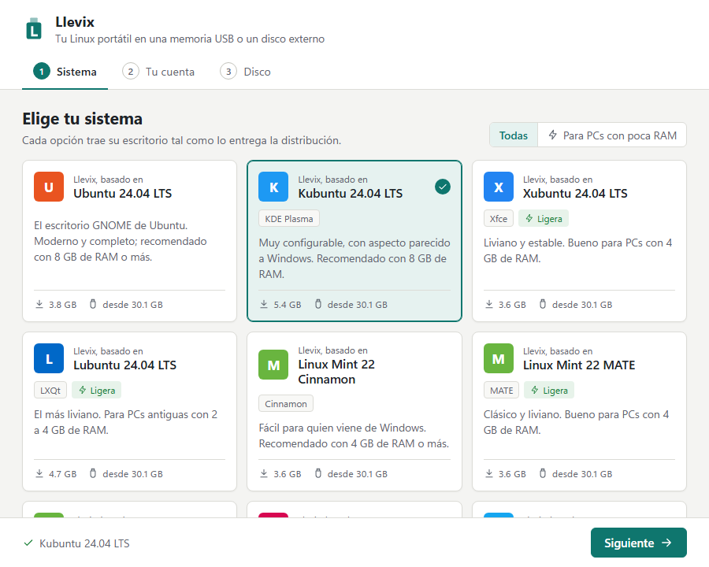
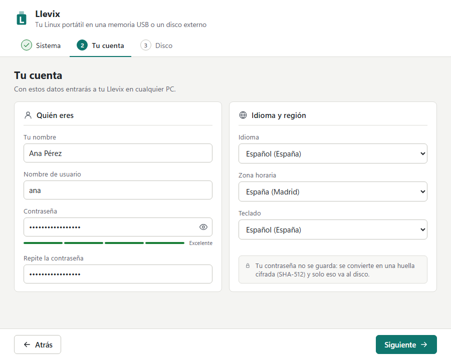
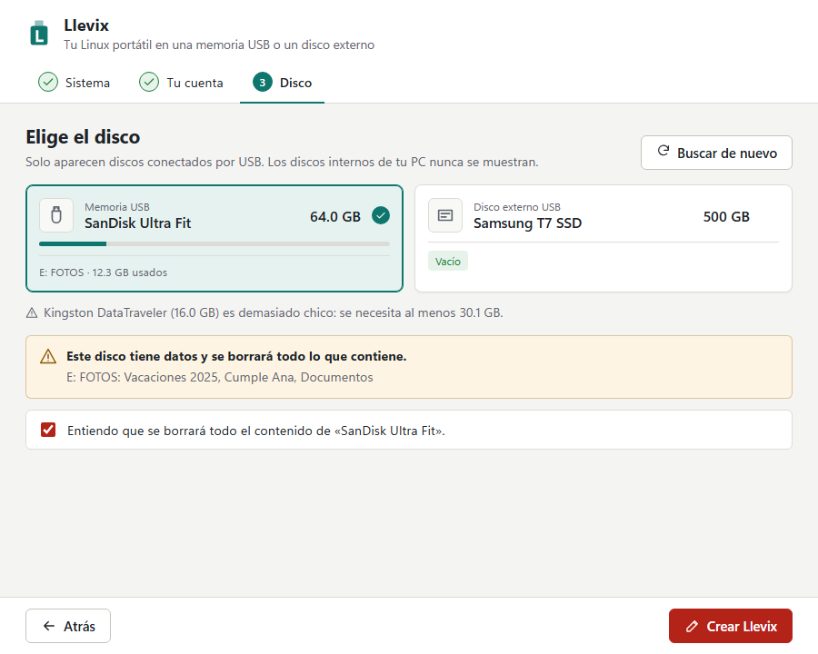
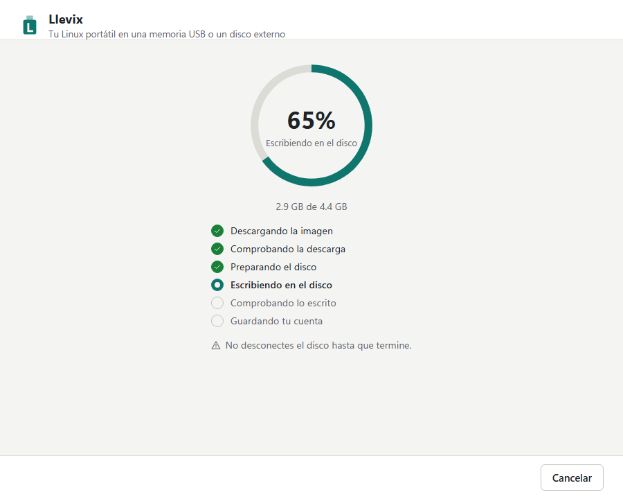
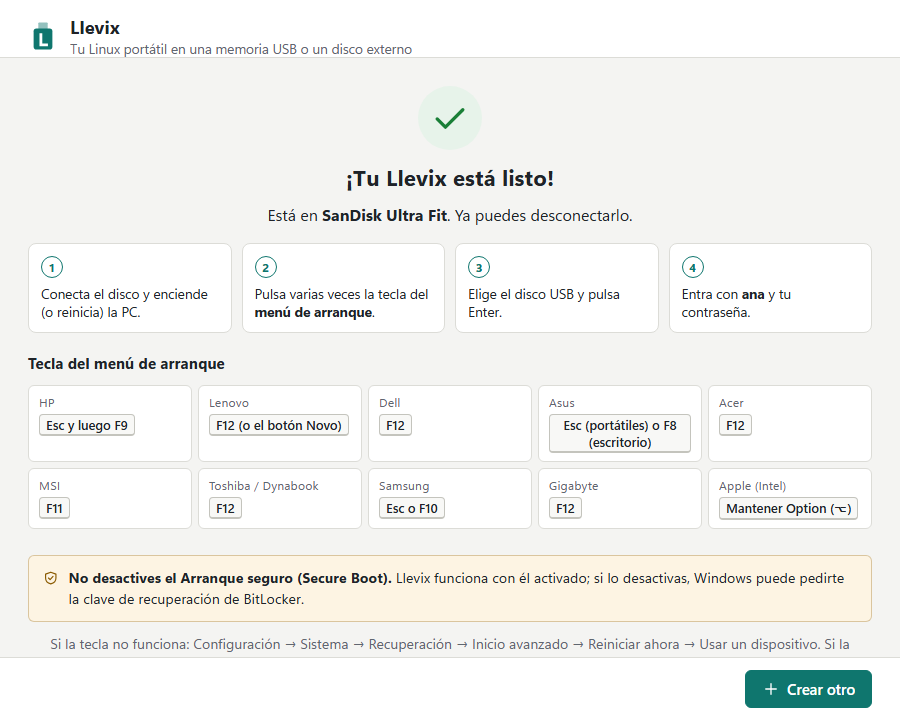
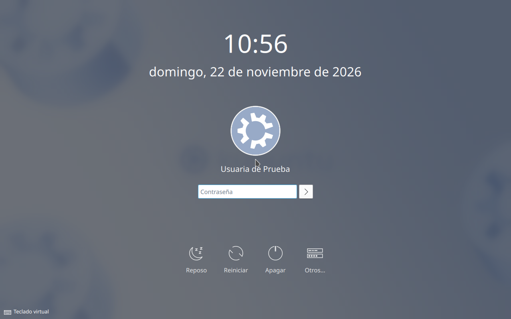
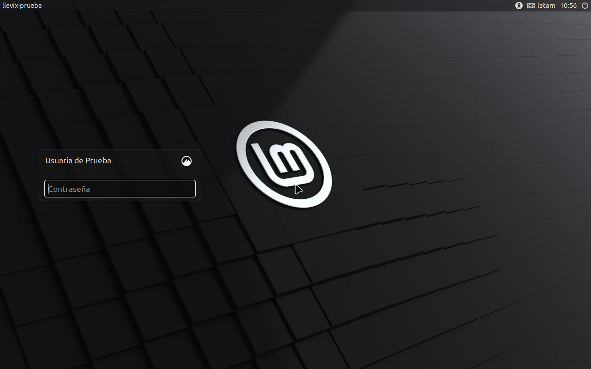
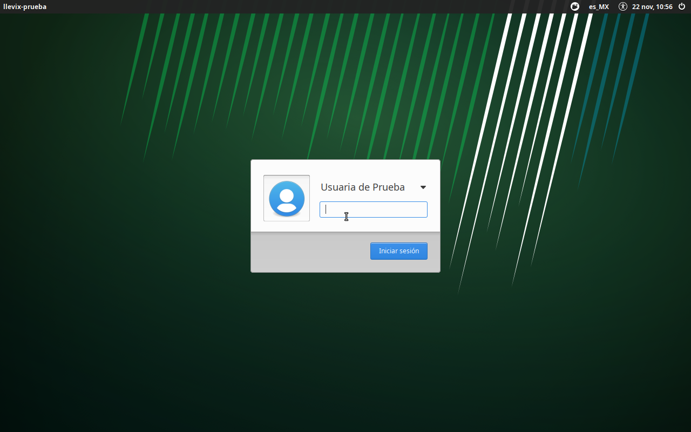

<h1 align="center">Llevix</h1>

  <strong>Tu Linux en el bolsillo.</strong> 
  Convierte una memoria USB o un disco externo en un Linux portátil que arranca en cualquier PC
  y guarda tus archivos de una computadora a otra.

  
  
  
  

  

- **Eliges la distribución**, escribes tu usuario y contraseña, y el disco queda listo.
- **Tus archivos y programas viajan contigo**: se conservan en cada PC donde lo conectes.
- **La carpeta Datos se abre también desde Windows y desde un celular Android.**
- **Funciona con el Arranque seguro (Secure Boot) activado**: no hay que tocar la BIOS.
- **¿Ya tienes una ISO?** Llevix también instala la tuya (familia Ubuntu: Ubuntu, Mint, Zorin…).

> **Estado: beta.** Todo pasa las pruebas automáticas en máquinas virtuales; ahora lo estamos
> probando en PCs reales. Si lo pruebas, [cuéntanos cómo te fue](docs/BETA.md).

## Cómo se usa

<table>
  <tr>
    <td width="50%"></td>
    <td width="50%"></td>
  </tr>
  <tr>
    <td><strong>2. Tu cuenta.</strong> Usuario, contraseña, idioma, zona horaria y teclado. La contraseña
      nunca se guarda: solo su huella cifrada (SHA-512).</td>
    <td><strong>3. El disco.</strong> Solo aparecen discos USB; los internos de tu PC nunca se muestran.
      Si el disco tiene datos, te dice qué contiene y pide confirmarlo dos veces.</td>
  </tr>
  <tr>
    <td></td>
    <td></td>
  </tr>
  <tr>
    <td><strong>Escritura.</strong> Descarga, comprueba la descarga, escribe solo lo necesario y
      verifica todo lo escrito.</td>
    <td><strong>¡Listo!</strong> Te explica cómo arrancar y qué tecla usar según la marca de tu PC.</td>
  </tr>
</table>

Y así se ve al arrancar desde el USB, con la cuenta que creaste, en español:

<table>
  <tr>
    <td width="33%"></td>
    <td width="33%"></td>
    <td width="33%"></td>
  </tr>
  <tr>
    <td align="center">Kubuntu (KDE Plasma)</td>
    <td align="center">Linux Mint (Cinnamon)</td>
    <td align="center">Xubuntu (Xfce)</td>
  </tr>
</table>

Capturas reales de las pruebas automáticas. El creador también tiene modo oscuro:
<a href="docs/img/creador-oscuro.png">ver captura</a>.

## Descarga

1. Ve a la [última versión](https://github.com/bel001/Llevix/releases/latest).
2. Descarga **Llevix-Creador-…-setup.exe** (Windows 10 u 11).
3. Instálalo, ábrelo y sigue los 3 pasos.

Windows puede mostrar «Windows protegió tu PC» porque el instalador todavía no está firmado:
pulsa «Más información» → «Ejecutar de todas formas».

**¿Ya tienes una ISO?** En el paso 1 elige **«Usar mi propia ISO»**. Llevix la instala en el
disco la primera vez que arranca. Por ahora acepta ISOs de 64 bits, de hasta 8 GB, de las
familias Ubuntu y Debian:

- **Probadas:** Ubuntu 24.04 o posterior, Kubuntu, Linux Mint 22 (Cinnamon, MATE y Xfce),
  Zorin OS 18 y Debian 13 (ISO live).
- **Deberían funcionar** (misma familia, aún sin probar): Xubuntu, Lubuntu, Ubuntu MATE,
  Ubuntu Budgie, elementary OS y las demás ISO live de Debian 13 (GNOME, KDE, Cinnamon…).
- **Todavía no** (el creador las reconoce y avisa antes de borrar nada): Fedora, Pop!_OS,
  Arch, Manjaro, EndeavourOS y openSUSE.

**¿Sin Windows?** Descarga la imagen `.img.zst` de tu variante (y sus partes `.001`, `.002`…
si las tiene), únelas, descomprímelas y escríbelas con balenaEtcher o `dd`. Sin el creador no
se configura la cuenta: en Ubuntu (GNOME) la bienvenida te pide crearla; en las demás entras
con `llevix` / `llevix` y te pide cambiar la contraseña.

## Variantes

| Variante | Escritorio | Pensada para |
| --- | --- | --- |
| Llevix, basado en Ubuntu 24.04 LTS | GNOME | PCs con 8 GB de RAM o más |
| Llevix, basado en Kubuntu 24.04 LTS | KDE Plasma | Aspecto parecido a Windows, 8 GB de RAM |
| Llevix, basado en Xubuntu 24.04 LTS | Xfce | **Ligera**, 4 GB de RAM |
| Llevix, basado en Lubuntu 24.04 LTS | LXQt | **Ligera**, PCs antiguas con 2 a 4 GB |
| Llevix, basado en Linux Mint 22 Cinnamon | Cinnamon | Fácil si vienes de Windows |
| Llevix, basado en Linux Mint 22 MATE | MATE | **Ligera**, clásica |
| Llevix, basado en Linux Mint 22 Xfce | Xfce | **Ligera** |
| Llevix, basado en Debian 13 GNOME | GNOME | Estable y sobrio, 8 GB de RAM |
| Llevix, basado en Debian 13 KDE Plasma | KDE Plasma | Muy configurable, 8 GB de RAM |
| Llevix, basado en Debian 13 Xfce | Xfce | **Ligera**, 4 GB de RAM |
| Llevix, basado en Zorin OS 18 Core | Zorin (GNOME) | Aspecto tipo Windows o macOS, 8 GB de RAM |

Cada variante trae su escritorio tal como lo entrega la distribución, con red, sonido,
navegador y todo lo básico listo para usar. Llevix es un proyecto independiente: no está
afiliado a Canonical, Linux Mint, Debian, Zorin ni las demás distribuciones.

## Requisitos

- Una memoria USB o disco externo de **32 GB o más** (mejor USB 3 o un SSD externo).
- Una PC x86_64 (Intel o AMD) de los últimos ~15 años, con UEFI o BIOS.
- Para crear el disco: Windows 10 u 11 y conexión a internet (descarga de 3 a 5 GB).

## Cómo arrancar

Conecta el disco, enciende la PC y pulsa la tecla del **menú de arranque de una sola vez**:

| HP | Lenovo | Dell | Asus | Acer | MSI | Toshiba | Samsung |
| --- | --- | --- | --- | --- | --- | --- | --- |
| Esc y F9 | F12 | F12 | Esc o F8 | F12 | F11 | F12 | Esc o F10 |

**No desactives Secure Boot.** En PCs con BitLocker, Windows podría pedirte la clave de
recuperación. Llevix arranca con Secure Boot activado.

## Preguntas frecuentes

**¿Borra mi Windows?** No. Llevix vive solo en el disco USB. Tu PC no se modifica.

**¿Se guardan mis archivos?** Sí. Todo lo que guardes (carpeta personal y **Datos**) sigue
ahí la próxima vez, en esta PC o en otra.

**¿Puedo ver mis archivos desde Windows o el celular?** Sí: la partición **LLEVIX** (tu
carpeta **Datos**) usa exFAT, que Windows, macOS y Android leen.

**La pantalla queda negra.** Reinicia y elige **«Llevix (modo gráficos seguros)»** en el menú.

**Actualicé y algo dejó de andar.** Antes de cada actualización, Llevix guarda un estado del
sistema. En el menú de arranque elige **«Llevix: volver a un estado anterior»**. Tus archivos
no se tocan.

**¿Qué pasa si desconecto el USB sin apagar?** El sistema usa btrfs y está probado para
resistir cortes de corriente. Igual, apaga siempre antes de desconectar.

**¿Es seguro?** Tu contraseña nunca se guarda en texto: el creador solo escribe su huella
cifrada (SHA-512). El creador nunca muestra ni escribe los discos internos de tu PC.

**¿Cuánto dura una memoria USB?** Llevix escribe lo menos posible (registros en RAM, `/tmp`
en RAM, compresión). Un SSD externo dura más y es más rápido.

## Desarrollo

| Carpeta | Contenido |
| --- | --- |
| `image/` | Construcción de las imágenes (bash + debootstrap) y el instalador de ISO |
| `creator/` | Creador para Windows (Tauri 2 + Svelte, núcleo en Rust) |
| `tests/` | Pruebas en QEMU: arranque, primer arranque, resistencia e ISO propia |
| `tools/` | Herramientas (`check-env.sh`, `make-config.sh`, `manifest.sh`, `report.sh`) |
| `docs/` | Documentación, planes y bitácora |

Empieza por [CONTRIBUTING.md](CONTRIBUTING.md) y `./tools/check-env.sh`. Para ver la interfaz
del creador en el navegador sin compilar la app: `npm --prefix creator run dev`.

## Licencia

El código de Llevix (scripts, creador, pruebas y documentación) se publica bajo la
**[licencia MIT](LICENSE)**: puedes usarlo, copiarlo, modificarlo y distribuirlo libremente,
también con fines comerciales, siempre que conserves el aviso de copyright y la licencia.

Las imágenes de Llevix incluyen software de Ubuntu, Linux Mint, Debian y Zorin OS, cada
programa con su propia licencia (GPL y otras). Cada versión publica la lista exacta de
paquetes (`llevix-<variante>.paquetes.txt`) y **el código fuente de todos ellos**
(`llevix-fuentes-<base>.tar.*`), con una oferta escrita válida por tres años: ver
[docs/CODIGO-FUENTE.md](docs/CODIGO-FUENTE.md).
